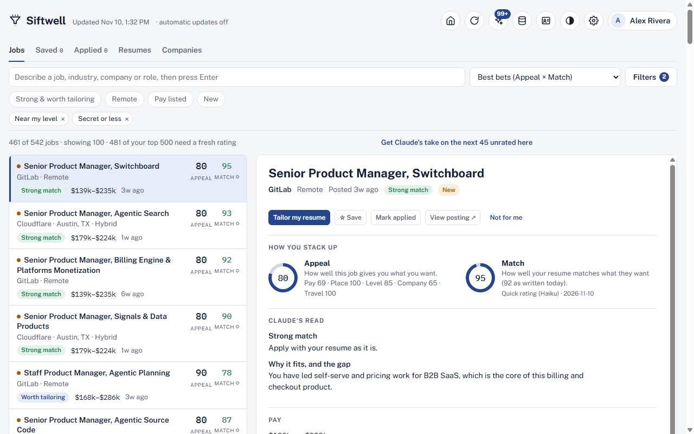

  <picture>
    <source media="(prefers-color-scheme: dark)" srcset="assets/brand/siftwell-logo-dark.svg">
    
  </picture>

# Siftwell

**Your own job search assistant that runs on your computer.** Siftwell reads job openings straight from employers' career sites, filters them to your location, pay and level, and (optionally, with Claude) rates how well each one fits your resume and tailors your resume for the best ones.

> Early preview. Free and open source (MIT).

## Download

Go to **[Releases → latest](https://github.com/chazzren/siftwell/releases/latest)**. **Which download do I want?** A Windows PC: the **Setup .exe**. A Mac from late 2020 on: the **.dmg**. Everything else is for special cases:

- **Siftwell-Setup-x.y.z.exe**: Windows installer (recommended). No admin needed.
- **Siftwell-Portable-x.y.z.zip**: Windows, no install. Unzip anywhere (even a USB stick) and run `Siftwell.exe`.
- **Siftwell-x.y.z.dmg**: Mac (Apple silicon). Open it and drag Siftwell onto Applications.
- **Siftwell-x.y.z.zip**: Mac with an Intel chip, or advanced. Unzip, then open **Start Siftwell**.

The first time, Windows may say **"Windows protected your PC"**: click **More info → Run anyway** (the app isn't code-signed yet). On a Mac, the first time, right-click **Siftwell** → **Open** (macOS 15: **System Settings → Privacy & Security → Open Anyway**); the guide has the steps.

## Get started

1. **Open Siftwell** and add yourself (several people can share one Siftwell).
2. **Set up your profile**: upload a resume (or fill in a short form), your home ZIP and radius, and the pay you're after.
3. **Click Start my job search** at the end of setup. Siftwell shows how many employers its free employer directory has near you (no Claude needed) and how long checking them takes, adds the ones you choose, then checks their career pages. Your board fills in with the openings that fit you.

Later, **Find new jobs** (the circular-arrow icon) checks your employers again, and you can add any employer by its careers-page link on the **Employers** page.

## What it does

- Reads jobs directly from employers' own career sites (20+ job systems), including ones that never reach the big job boards.
- Filters by distance from your home, remote or in person, pay, seniority, travel and requirements.
- Scores every job on **Relevant** (how close it is to the work you do), **Appeal** (how good it is for you) and, with Claude, **Match** (how well your resume fits).
- Plain-English search, saved and applied tracking, and resume tailoring (PDF or Word).
- A free, weekly-updated [employer directory](docs/GUIDE.md#the-siftwell-employer-directory) finds employers near you (only state-level files are downloaded; Claude can optionally find more), and you can share company lists with friends.
- Works on your phone over your home Wi-Fi, and tells you when a new version is out (the installed version updates itself).

## What you need

- A Windows 11 PC (Windows 10 usually works too), or a Mac (Apple-chip Macs use the .dmg; Intel Macs the ZIP).
- **Optional:** a Claude subscription. Connect it in **Settings → Get started** to unlock Match ratings, resume reading and tailoring. Siftwell works without it.

## Your data stays on your computer

Your resumes, profiles, saved jobs and ratings live only on your PC, never in the cloud. If you connect Claude, job descriptions and your resume are sent to Claude only to rate and tailor.

## More

- **[User guide](docs/GUIDE.md)**: starts with a ten-line Quick start, then every page and setting.
- [Install details](docs/GUIDE.md#install) · [Using it without Claude](docs/GUIDE.md#using-siftwell-without-claude) · [Updating](docs/GUIDE.md#updating-siftwell) · [Backups & moving computers](docs/GUIDE.md#moving-to-another-computer--backups)
- **[More options & troubleshooting](docs/ADVANCED.md)**: portable version, ZIP, uninstalling, where files are kept, troubleshooting.
- License: [MIT](LICENSE)
